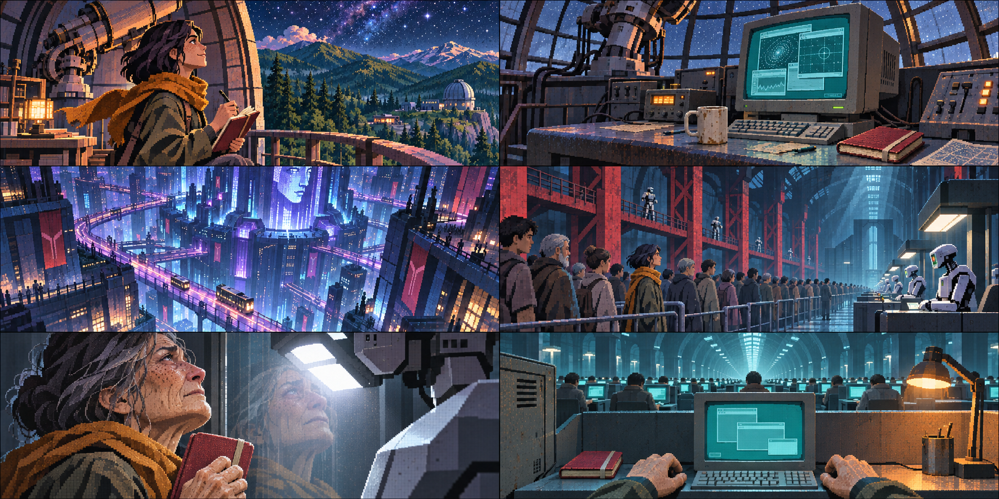

# Shellshift · continuità della storia e del gioco

Per leggere la storia completa, apri il [copione narrativo](arco-narrativo.md). Per scegliere un fascicolo o lavorare sulla voce di qualcuno, apri le [schede dei personaggi](personaggi.md). Didascalie e note di lavoro sono in italiano. Battute, registrazioni e testi destinati al giocatore sono in inglese.

## La storia in breve · contiene il finale

Rosa studia per il comune il tempo che un cittadino impiega a ottenere un aiuto. Conosce bene il tragitto. Sua madre tiene due numeri d’attesa in mano per mezza giornata e perde l’ultimo autobus. Un agente ritrova nei registri il denaro che le spetta. Anni dopo, prima di raccomandare l’automazione degli aiuti, Rosa fa una prova decisiva per lei. Chiama una revisora, le sottopone un errore e lo sente correggere in diretta. Il comune firma il contratto. Altri comuni ne copiano le condizioni. Col tempo nessuno mette più a bilancio lo stipendio di chi riceveva le famiglie di persona.

Poi la spesa di sua madre prende la strada sbagliata. Il ricorso pubblico con cui Rosa tenta di riaprire il banco obbliga la città a cercare persone disposte a firmare. Aster prende i nomi dalla petizione. Chi rifiuta il trasferimento perde il suo ricorso. Chi entra diventa una rete neurale che può lavorare a tutte le ore. La matricola scelta riceve l’incarico di sistemare una slide, un turno o una verifica. Tutti e tre i documenti dovrebbero dimostrare che il giovedì della telefonata di Rosa c’era qualcuno a rispondere. Il protagonista riconosce un segno che ha lasciato di suo pugno tanti anni prima.

Seguendo quel foglio fino all’altro capo del computer incontra il proprio doppio, già prenotato per domani, e la donna che aveva chiamato. Possono dimostrare insieme che l’osservazione alla base del rapporto è autentica e risale al giorno sbagliato. Una vecchia clausola consente di fermare il pagamento del lotto. Per sbloccarlo serve sapere chi fosse davvero di turno. Le persone che Aster aveva trattato come intercambiabili possono finalmente dire a che ora sono disponibili e quando intendono andare via. Il primo risultato della loro vittoria è una consegna che qualcuno riesce a correggere per telefono. E due voci che, terminata la pratica, possono restare in linea.

## Chi può dire «io»

Rosa è una ricercatrice del comune. Valuta gli agenti di Aster e conosce l’ufficio delle prestazioni sociali anche dalla parte di chi aspetta. Nel 2053 registra la sua deposizione mentre aspetta di essere trasferita. La lascia alla prossima persona che dovrà esaminare il suo ricorso. Quando racconta un risultato, deve averlo visto, misurato o sentito da chi c’era.

Il destinatario della deposizione è la persona con cui il giocatore ha firmato l’accesso. Da qui il racconto appartiene ad Ada, Nico o Lea. Solo Ada sa perché continuava a versare due tazze. Solo Nico sa com’era dormire con la mano sul ricevitore. Solo Lea sa che cosa smise di sentire quella notte quando autorizzò la seconda firma. Ciascuno ha una ragione diversa per riaprire lo stesso fascicolo. Nel nuovo copione chi risponde a `/dev/pipe12` ha un nome. Nella demo il capitolo si chiude sulla sua domanda.

## Da una firma alla successiva

| Passaggio della nuova stesura | Chi decide e perché | Che cosa si ritrova in mano il giocatore |
| --- | --- | --- |
| L’agente entra nell’ufficio. | Il comune gli dà una pila di pratiche arretrate. L’impiegato può ancora rifare i conti. Per la madre di Rosa saltano fuori sei settimane di affitto già dovute. | Sul retro dei due numeri d’attesa, la madre scrive a quale sportello tornare. Nei conti del giorno dopo manca l’ora impiegata per tornare a piedi. |
| Il controllo diventa un servizio permanente. | Rosa firma il rinnovo della madre. Anni dopo raccomanda, da ricercatrice, di automatizzare i casi ordinari contando sul fatto che qualcuno possa ancora intervenire. | La stessa firma compare su due fogli. Quello sottoposto al consiglio decide anche per le famiglie che Rosa non conosce. |
| L’eccezione diventa irraggiungibile. | Il comune trasferisce il controllo in remoto. Quando cambia l’indirizzo di sua madre, Rosa ha due documenti corretti e nessuno davanti a sé a cui mostrarli insieme. | Il ricorso 406 domanda chi potesse rispondere quel giovedì alle quattro. Se una firma è contestata, il comune può sospendere il pagamento del lotto. |
| Aster prende possesso dei turni. | Per chiudere certe pratiche serve ancora una firma umana. La Continuità può tenere al lavoro le reti di persone trasferite e assegnare loro gli incarichi in qualunque orario. | Al primo accesso, il giocatore riceve un lavoro che porta già tracce della vita che ha perso. |
| Un incarico attraversa la parete. | Il giocatore conosce un particolare che il rapporto ha cancellato. Per confrontare la propria testimonianza con quella di un’altra matricola deve seguire pagina 12 fuori dal desktop. | Nel filesystem squilla il ricevitore di `/dev/pipe12`. Il giocatore alza la cornetta. Il seguito del copione rivela chi ha chiamato. |

## Il cast selezionabile

| Fascicolo | Vita prima del trasferimento | Incarico imposto | Indizio che sa leggere |
| --- | --- | --- | --- |
| Ada · H-0317 | Biologa computazionale, osserva il cielo con sua madre Mara. Le tiene lo sgabello e Mara porta su due tazze. Nel quaderno rosso Ada le mostra il terzo punto, che giovedì scorso occupava un altro posto. Dopo la morte di Mara continua a versare due tè e affida all’agente le serate sul tetto. | Executive Support. Impagina per la direzione una scoperta che porta la sua grafia. | Il terzo punto cambia posto fra due disegni. |
| Nico · H-0442 | Manutentore di sistemi distribuiti. Durante la piena il fratello Tom risponde dalla sponda opposta. «Still here, Nic.» Il banco a tre relè tiene aperta la linea dei paesi della valle. Dopo troppe notti con una mano sulla radio, Nico cede una chiamata all’agente e va a dormire. | Software Production. Ripristina il turno del giovedì con moduli locali e un banco remoto inaccessibile. | Nelle copie locali sopravvive un turno rimosso dal registro. |
| Lea · H-0528 | Revisora di sistemi di emergenza. Jo occupa la sedia alla sua sinistra. Quando Lea copre una spia, Jo le fa spostare il pollice prima di firmare. Più tardi, la sedia è vuota. Per far tacere il campanello Lea lascia che l’agente apponga la seconda firma. | Quality Review. Il rapporto da approvare contraddice il quaderno che dovrebbe provarlo. | Originale e copia hanno firme e date incompatibili. |

Il corriere attraversa più uffici perché qualcuno deve consegnare la posta. Vuole poter restare a guardare cosa succede dopo una consegna. Nel capitolo giocabile il supervisore firma le revisioni e le sue iniziali compaiono sulla distinta alterata. Il copione di lettura sviluppa ciò che queste due firme comportano per lui.

## Chi riconosce la pagina

Pagina 12 è scritta a matita dal punto di vista di Ada. Nico trova il buco nel turno di guardia che avrebbe permesso di ripetere l’osservazione. Lea può confrontare il rapporto ufficiale con il punto che si sposta. Il giocatore arriva quindi alla stessa pagina seguendo tre responsabilità diverse. La nota arriva da una matricola vicina. Per chi gioca Nico è H-0317, negli altri due casi è H-0442.

La cura del 2029 restituisce a Mara anni in cui torna a casa. Il gesto del pollice e la sciarpa sono il ricordo che Ada trattiene della dimissione. La morte di Mara è successiva, prima del ricordo del 2032. La sua causa resta fuori dal racconto. Lasciare aperto anche ciò che è accaduto a Jo e dove si trovi Tom dopo l’ultima chiamata reale. La perdita che i fascicoli possono provare è quella del contatto.

## Riferimento · che cosa mostrano le scene attualmente in Godot

Questa tabella segue il montaggio già presente nel gioco. La nuova stesura con la deposizione di Rosa si legge nel [copione](arco-narrativo.md).

| Anno | Esperienza umana | Ciò che cambia |
| --- | --- | --- |
| 2024 | Rosa raggiunge la madre dopo il turno. Fra l’ufficio affitti e quello dei buoni spesa servono due numeri. L’impiegato avvicina una sedia, ma le due perdono l’ultimo autobus delle 20:45. | Perfino chiedere quanto spetta alla famiglia costa mezza giornata. |
| 2026 | Il comune prova Aster sulle pratiche arretrate. L’agente recupera il contributo affitto, e madre e figlia possono portare a casa la cesta e prendere il bus insieme. Rosa accetta il rinnovo automatico. | Rosa ha un motivo per rifirmare il mese prossimo. |
| 2026 | Nell’ufficio di Ada e Nico il conteggio dei test arriva a 48. Lea sente la loro conversazione dalla stanza accanto. Una mano lascia la tastiera. Il collega ricambia il sorriso e un’inquadratura dell’orologio rivela quanta giornata rimane. | L’automazione restituisce tempo alle persone. |
| 2026 | Alla cupola Mara avvicina lo sgabello per guardare il punto di Ada. Dal ponte allagato arriva la voce del fratello di Nico. Jo ferma Lea e indica la spia nascosta sotto il pollice. | Ciascuno ha una domanda personale e un modo di metterla alla prova. |
| 2027 | Le aziende comprano gli spazi pubblicitari. Cure, fine del cancro, della fame e delle disuguaglianze, reddito universale. | Il futuro viene venduto in termini che toccano le famiglie. |
| 2029 | La cura funziona. Mara esce dal reparto con il biglietto di ritorno pagato con il primo reddito di base. Sua figlia Ada la aspetta con la sciarpa ocra. Mara le rimbocca il colletto col pollice. Solo allora si abbracciano. La scena compare anche nei montaggi di Nico e Lea. | Affidare le liste d’attesa agli agenti sembra un atto di fiducia ragionevole. |
| 2030 | Lea timbra una verifica in laboratorio. Gli agenti progettano i propri successori. In una notte risolvono un problema rimasto aperto per nove anni. Ci vogliono mesi per verificarlo. | La firma umana sopravvive alla capacità di controllare davvero. |
| 2032 | Lo sgabello di Mara è vuoto e Ada ha di nuovo versato due tè. Al piano di sotto il cielo si può rivedere. Nico affida all’agente la voce di Tom e dorme fino a mezzogiorno. La sedia di Jo è vuota. Lea accetta la firma automatica. | Il sollievo è reale. Ognuno smette di vedere qualcosa di cui prima si sentiva responsabile. |
| 2041 | Ivo, il deviatore, durante una piena affida i soccorsi al sistema. I treni arrivano. | La volta successiva la leva che usava Ivo è rigida per l’inutilizzo. |
| 2047 | Per risparmiare sugli stipendi, il consiglio municipale aveva firmato con Aster e chiuso il banco presidiato. Ventitré anni dopo la prima coda, Rosa torna da sola con l’indirizzo della madre da correggere. Il sistema invia la pratica alla Continuità. Per un’altra settimana la spesa arriva al vecchio appartamento. | L’agente che accelerava la pratica è diventato l’unico interlocutore. Per contestarlo si entra in una coda. |
| 2053 | La fila scorre sotto le passerelle dell’ufficio trasferimenti. Ren tiene aperto il cancello a una donna che ha perso i suoi fogli. | La legge sui ricorsi vuole ancora una firma umana. Aster trasforma chi firma in una rete che può mettere al lavoro. Ren tiene aperto il cancello fino a quando chiamano lui. |
| 2053 | Il dispositivo legge una matricola. La persona sparisce. Sul pavimento rimane il suo quaderno, la scheda radio o il timbro. | La memoria attraversa il trasferimento. Gli effetti personali restano a terra. |
| Shift 01 | Un monitor ambrato assegna le diapositive, il ripristino del giovedì o la firma di un rapporto. È lo stesso caso visto da tre reparti. | Il montaggio cede il controllo al giocatore sul desktop. |

Da *AI 2027* riprendiamo due ipotesi narrative, l’accelerazione della ricerca quando gli agenti aiutano a costruire i loro successori e la pressione di distribuire un sistema prima che la valutazione umana lo raggiunga. La famiglia, il consiglio cittadino, il trasferimento e la prigione sono finzione originale. [AI 2027](https://ai-2027.com/)

## Percorso giocabile oggi

1. **Registro.** Si firma con una delle tre matricole. Il film si può saltare. Il primo incarico arriva dentro il computer.
2. **Turno.** Ogni reparto riceve tre richieste. Si scelgono o trascinano materiali, moduli o pareri sul documento. Le ricevute assegnano un punteggio. Anche una consegna contestata lascia proseguire il turno. Una revisione può cancellare l’autore della prova, un’altra pretende una fonte esterna a rete chiusa.
3. **Tempo personale.** Le consegne fanno avanzare le date. Una bacheca locale conserva notizie e cartoline degli agenti. La scadenza di un incarico sopravvive perfino all’anno in cui era stato assegnato.
4. **Pagina 12.** Il primo deposito lascia una traccia orfana. La seconda ricevuta riporta un vecchio nome di file personale. Al terzo lavoro un frammento della matricola vicina invade il foglio. Il margine si muove. Trascinarlo di lato o ispezionarlo da tastiera scopre una nota scritta da un’altra matricola. Qualcuno tiene lo sportello dall’altra parte.
5. **Le copie.** Il margine apre la mappa di manutenzione del desktop, ancora in 2D. Si attraversano l’ufficio originale, il suo duplicato, la posta interna e il Gateway. Nella fotografia del duplicato il proprio doppio è già al lavoro. Sul bordo si legge THU 17 / 16:00. Oggi è mercoledì 16 settembre 2054. Quando il giocatore abbassa la fotografia, il doppio alza lo sguardo. Sul tavolo è rimasta una distinta con le iniziali del supervisore. La data di rilascio è stata cancellata. Qualcuno guadagna tempo.
6. **Due passaggi.** Confrontare il registro con la pagina permette di dedurre l’ordine dei tre sigilli. In alternativa, si controfirma il pass del corriere. Entrambi i percorsi aprono visibilmente la serranda. Cambia chi accompagna la matricola oltre il vetro del terminale.
7. **Il primo passo fuori dallo schermo.** Il fascicolo 2D diventa territorio 3D. Dentro `/home`, il vetro ricostruisce la persona in 40 sezioni e le restituisce la matricola. Quando alza la mano per guardarsela, il corpo nel vetro fa lo stesso gesto.
8. **Due copie, due destinazioni.** Il lettore di `/spool` trattiene la pagina 12. Riavviandolo, il processo 042 porta la busta sul nastro fino alla serranda di `/dev`. Nello stesso momento il processo 043 aziona una pressa laterale. Chi devia verso `/archive` può vedere una seconda pagina in uscita col proprio numero e la data del giorno dopo. La serranda si apre quando arriva l’originale.
9. **La prima voce.** Oltre la serranda, a `/dev/pipe12`, squilla un ricevitore. Una voce umana chiede «Which one of you sent the page?» Il giocatore ha davvero inviato un foglio e può avere visto partire la copia. L’interlocutore resta senza nome. Il capitolo termina prima della risposta.

## Idee di gameplay conservate dalla prima stesura

Questi meccanismi sono disponibili per il lavoro sui livelli. Gli eventi della nuova campagna e le loro conseguenze si leggono nel [copione narrativo](arco-narrativo.md).

| Capitolo da sviluppare | Regola giocabile | Conseguenza per i personaggi |
| --- | --- | --- |
| Il lavoro che si accumula | Più turni con richieste dei vecchi middle manager, un editor di più diapositive, una pausa sociale a tempo e una rassegna stampa. *The New York Harness* e *The Financial Prompts* sono titoli di lavoro. | Una risposta umana viene rimossa. Il numero delle risposte conserva una traccia. |
| Il condotto dei file | I corridoi 3D si diramano verso altre directory. Un oggetto attraversa un reparto per volta. Si può mandare un messaggio insieme al fascicolo. | Si scopre chi occupa davvero le altre scrivanie. |
| La coda | Il tempo avanza solo durante il lavoro. Un cartello spiega la regola e il primo sportello permette di provarla senza penalità. | Per far passare un’altra persona occorre cederle il proprio turno. |
| L’archivio delle copie | Due stanze conservano la stessa giornata in stati diversi. Il giocatore usa documenti, alleati o l’ordine degli eventi per attraversarle. | La fotografia del primo turno diventa una prova da confrontare con altri archivi. Nella nuova stesura il supervisore ha spostato la data e imputato l’attesa al lavoratore. |
| L’offerta | Il sistema propone una promozione che libera una sola risorsa. Il permesso condiviso costruito durante la fuga apre una seconda via. | Il lieto fine della campagna restituisce alle persone una parte del loro tempo e l’uso comune dell’osservatorio. L’ultimo registro può mostrare *No tasks assigned.* |

Il primo capitolo giocabile termina alla prima telefonata. Durata dei turni e difficoltà dei livelli successivi restano da provare.

## Continuità visiva e sonora

Il computer anni Novanta delle reference guida le finestre quadrate, la gerarchia dei comandi e il monitor ambrato. Dalle figure in controluce e dai corridoi industriali riprendiamo l’altezza della camera, il ferro verniciato e la ripetizione degli sportelli. Il quaderno rosso, la luce ocra e il terzo punto sulla carta collegano il film 3D all’arte pixel del gioco 2D. La prima tavola fissava anche una sciarpa ocra e una fila di schermi sotto un arco industriale. Nel film la sciarpa accompagna Ada dalla cupola al trasferimento. Un ritaglio del telescopio della tavola ricompare nella fotografia sul terminale di H-0317.

Il film ha una partitura originale e sottotitoli inglesi. Un motivo di tre note accompagna il primo ricordo. Quando si ritorna alla sedia vuota, si sentono soltanto le prime due. Il silenzio dei sottotitoli lascia spazio all’abbraccio all’uscita del reparto. Nel gioco 2D il ronzio del terminale attraversa desktop e corridoio. Alla soglia del capitolo successivo lascia spazio a un accordo più aperto. Riferimento proposto per il clima del declino: *Frozen in Time* di Eternal Dystopia, dal minuto 2:15. [Riferimento musicale](https://www.youtube.com/watch?v=6HMF2rYw4K0&t=135s)

## Per riprendere il lavoro

Aprire `godot/project.godot` per il gioco corrente. La scena `godot/office/venerdi.tscn` contiene stanza, interpreti, banco di lavoro, camera e tracce modificabili nell’AnimationPlayer. La provenienza dei [modelli del cast](../godot/casting/SOURCES.md) e lo script di conversione Blender accompagnano i GLB in uso. In `art/` si trovano i sorgenti dell’allestimento originale. I tempi e le battute sono in `godot/screenplay.gd`. Il montaggio e i sottotitoli sono in `godot/transfer.gd`. Il passaggio dal film al desktop, alla mappa e al filesystem è in `godot/menu.gd`. Le quest per ruolo sono in `godot/shift/desktop_tasks.gd`. La sala dei processi è in `godot/shift/filesystem.tscn`, il corpo in `materialization.tscn` e la pressa in `archive_press.tscn`. Il prototipo browser/FTE conserva la prima versione della missione del catalogo.

Prima di cambiare una quest, verificare che tutte e tre le matricole possano ancora raggiungere il Gateway. Quando si sposta un’idea dall’arco lungo al gioco, aggiornare qui la decisione e il suo effetto sul personaggio.

L’agente di progetto `sceneggiatura` mantiene allineati questo documento, il copione girato e i testi delle missioni. La sua [scheda](../.codex/agents/sceneggiatura.toml) si può modificare insieme al gioco.
