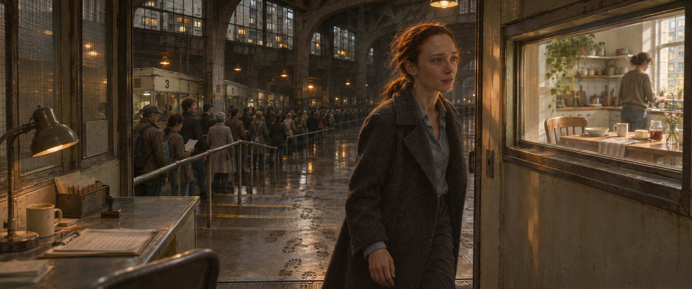

# Hbiotic · Fotogrammi di riferimento

Il primo piano di *Buonanotte* è il riferimento scelto con l’autore per il volto della biologa, i capelli rossi e l’ambientazione del laboratorio. Fotogrammi di prova realizzati con ImageGen. Battute e nomi di scena sono provvisori.

## Buonanotte

La biologa torna indietro per salutare Xiv-83. La macchina si accorge che è la prima volta.

### Provino in Blender

[Guarda il filmato con audio](buonanotte-demo.mp4) · [Apri le scene in Blender](buonanotte-demo.blend)

Il provino dura 4,75 secondi a 24 fotogrammi al secondo. Si accende la spia di Xiv. Sul rumore della ventola, la biologa alza appena gli occhi. La testa segue lo sguardo e la coda si assesta. L’attaccatura resta ancorata al cranio. Le lunghezze raccolte e i ciuffi alle tempie rispondono alla rotazione con due movimenti elastici distinti, registrati nella timeline.

Tieni l’MP4 accanto al file Blender. **Playback** apre una copia del filmato al fotogramma 40. Con il puntatore sull’anteprima, **Maiusc + ←** torna all’inizio e **Spazio** riproduce il filmato con l’audio. **Set 3D** apre il laboratorio e il personaggio in una vista leggera con un quinto dei capelli. Il render usa tutti i filamenti. **Edit** contiene le due inquadrature originali e il suono del laboratorio. Le texture e l’audio sono incorporati nel progetto.

La testa e le mappe della pelle derivano da *Female Head Textured* di Dessen. Per il provino sono stati adattati l’incarnato, le iridi blu ardesia, le palpebre e l’espressione. [Modello originale](https://sketchfab.com/3d-models/female-head-textured-e774147bf2224e6f83ec89f67ec2ecb6) · [Licenza CC BY 4.0](https://creativecommons.org/licenses/by/4.0/)

Il corpo e gli abiti derivano da *Business Female 01* di Microsoft Rocketbox. La posa, il collo della camicia e i materiali sono stati adattati al personaggio. Le ciocche, il laboratorio, il terminale e il suono sono stati costruiti per questa scena. [Modello originale](https://github.com/microsoft/Microsoft-Rocketbox/tree/0943055db6ec570bcef9f2c8b41c9e5467c808f9/Assets/Avatars/Professions/Business_Female_01) · [Licenza MIT](../../godot/casting/LICENSE-Rocketbox.txt)

### Prove di voce in inglese

[Il lunedì a Hbiotic, 10,4 secondi](hbiotic-monday.wav). “That Monday, a paper landed in my inbox. I meant to read it. What I remember is my lab partner asking if I could cover Saturday.”

[Il saluto a Xiv, 2 secondi](buonanotte-voce.wav). “I forgot to say goodnight.”

Entrambe le tracce sono voci isolate per il montaggio. Sono state generate in locale con il preset Serena di Qwen3-TTS-12Hz-0.6B-CustomVoice, revisione `85e237c12c027371202489a0ec509ded67b5e4b5`, e salvate in WAV mono a 24 kHz e 24 bit. Il video contiene il missaggio originale della ventola e del relè. [Scheda del modello e licenza Apache 2.0](https://huggingface.co/Qwen/Qwen3-TTS-12Hz-0.6B-CustomVoice)

## I due caffè

La biologa porta una notizia alla collega. Ha già posato il secondo caffè quando vede il posto vuoto.

## Compresa me

La sala del trasferimento è stata ricavata da una rimessa dei tram. Sul vetro della cabina si vede una sedia libera al tavolo della colazione.

## Il primo provino di movimento

Quattro secondi, camera ferma all’altezza del terminale. Si parte da *Buonanotte*. La biologa sente finire la risposta di Xiv-83. Gli occhi tornano sulla piccola spia d’ascolto. Inspira per parlare, poi ci ripensa. Si sente la ventola del laboratorio. Il controcampo della macchina può aspettare.

**Indicazione in inglese per un provino image-to-video**
Locked camera at the terminal’s eye level. Keep the framing, copper hair, face and room lighting of the starting still. She hears the last word of a reply. Only her eyes shift slightly towards the listening lamp. After a beat, she draws a breath as if to speak, then lets it go. Four seconds in real time. Room tone and a distant fan. No spoken line, music or camera move.

Prompt di generazione

Il primo fotogramma usa come riferimento il volto in primo piano a 00:16.5 del [provino del cast](../provino-cast.mp4). Gli altri due usano il primo fotogramma.

**Buonanotte**

Use case: identity-preserve. Create ONE full-bleed horizontal 2.39:1 live-action motion-picture frame for Shellshift, not a panel sheet. Reference image: use ONLY the younger woman in foreground as the casting reference. Keep her recognizable long oval face, distinctive wide green-grey eyes, fine level brows, straight nose, slightly projecting ears and mouth proportions as a real human performer in her early thirties. Her hair is clearly copper red/auburn, drawn back in a simple ponytail with stray copper wisps. Translate the subject into real photographed flesh and discard the game aesthetic, original pose, older woman, telescope and costume.
THE SHOT: At the end of her shift a biologist in the Hbiotic lab has come back in her charcoal cardigan and unbuttoned pale blue work shirt to say goodnight to the lab's AI Xiv-83. It remembers that she has never returned to say it before. Catch a reaction, mid-breath, turning back over her shoulder toward the dark terminal, her upper lip about to break into an embarrassed half-smile. Camera is at the height of the terminal lens, almost the person she is looking at. Intimate 65 mm three-quarter closeup, her eyes and expression carry the shot, her face just left of center, a thin out-of-focus screen edge and a single tiny amber listening lamp in the lower right foreground. The room reads as a working tissue lab (microscope and stack of trays in soft focus). Steel, laminated cream cabinets, dirty wired-glass partition. Warm sodium light from the city catches individual wisps of red hair; soft green-grey spill from equipment models her far cheek but keep skin warmly alive and BOTH eyes readable. Quiet, humane, unposed, analogue 35 mm grain and deep warm blacks, realistic optics, rich shadow detail, practical set of an original mid-budget European science-fiction drama. Single still of an actor doing something private, no cosmetic retouch, no stylization or CGI sheen. No words, titles, watermarks, subtitles or black bars.

**I due caffè**

Use case: identity-preserve. ONE photorealistic live-action widescreen frame, 2.39:1 edge-to-edge without black bars. Reference still is the actual finished movie's cast, standing set, colour, skin and film negative. This is a DIFFERENT shot on the same set of that movie. Same woman exactly, the green eyes, natural freckles, fine straight nose, ears, copper-red ponytail, faded slate-blue cotton shirt and dark wool cardigan. Preserve the taste of that first frame: warm sodium light and smoked wired glass, old cream built-in cabinets, rich dense blacks, restful and tactile.
Shot 2, several months later. The biologist has walked over with TWO small open takeaway coffee cups, one for her colleague, the other her own. The colleague accepted the exit bonus without telling her. The actor has just arrived at the empty station, and almost by habit has SET ONE CUP DOWN in front of the vacant chair. Her hand is still resting loosely against its side; her OTHER hand holds her OWN cup near her waist. She has begun to say something, then stops. A small slackness in her mouth, she stands completely still. Do not pose her toward the viewer. Empty workstation and woman equally important: medium-wide, 40mm lens from the former coworker's side, old wood swivel chair very close as dark silhouette at left, an empty strip of workbench recedes toward the woman on the right in readable three-quarter profile; pale, dust-free little rectangle on the wall where a photograph had been. Camera sees her from hip to head. Gentle late-winter daylight through tall wired glass and a pool of sodium from a wall light. Daytime version of the same actual place. No city outside is required. Honest scale, physically correct hands and cups, unobtrusive 35mm grain, strong but unshowy narrative composition of a real feature film. No dramatic crying, no ghosts, no mannequin, no words, no subtitles, no poster treatment or split frames.

**Compresa me**

Use case: identity-preserve. Create ONE original full-bleed 2.39:1 live-action frame from the same film as the reference. Keep the unmistakable face of the same actor: elongated oval, green-grey eyes, pale freckles, fine straight nose, distinct slightly prominent ear, copper-red ponytail, minimal makeup, now a few years older in a charcoal wool coat over faded blue shirt. Preserve the reference's earthy ochre and desaturated green-grey palette and photographed 35mm texture, practical amber light catching her red hair. New location but the exact same everyday world: a civic transfer hall inside a converted urban tram depot, worn cream enamel numbered booths, smoked wired glass, high concrete beams, wet boot prints, distant stacked apartment windows and amber service lights visible through clerestory glass, people with ordinary clothes waiting. A future that really could have been built piecemeal. Space feels civic, enormous, dim, still in use. No flashy sci-fi decor.
Shot 3, 'Me too.' Dramatic human moment, wide 28 mm environmental movie shot taken from inside an unoccupied booth over the height of an ordinary desk. In the immediate middle foreground, off center, the red-haired woman has come right up to the threshold and has one foot across it. We can see her face clearly in three-quarter profile and only one of her hands. One small broad window immediately beside the doorway shows where she expects to arrive: her own homely, modest kitchen in clear morning light, sibling barely visible out of focus arranging breakfast, an unoccupied second seat at the table. It is a recessed optical display with real glass and physical depth, from this angle the kitchen is literally the size of a window in her world. Warm light from it touches the woman's face. Beyond her the rain-damp queue descends a few steps and curls back under the deep ribs of the old depot into darkness. Framing reads with one glance: person, inviting luminous domestic window, immensity of the queue. Leave emotional room for both longing and misgiving. Match the whole frame exposure to the reference, faces legible, black level with subtle detail. No swirling portal or circular glowing ring, no helmets, no holograms or floating components, no giant ads, no lasers, no existing film characters or iconic landmarks, no readable signage, no captions, no black bars. High-end production still in a grounded, physically built world.

